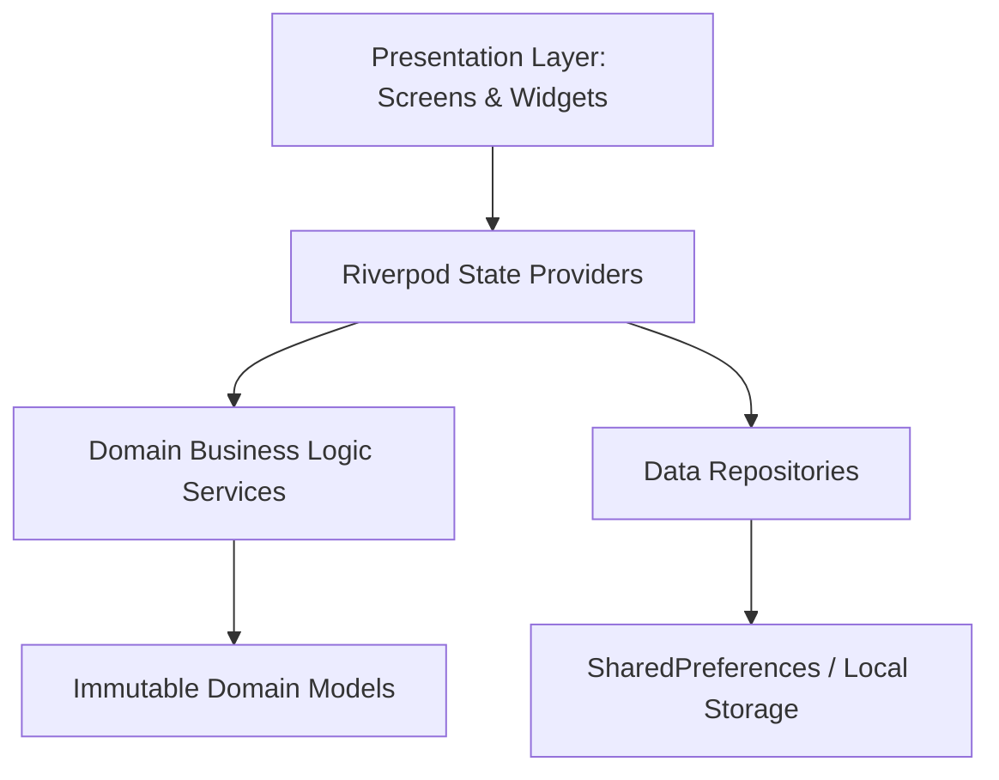
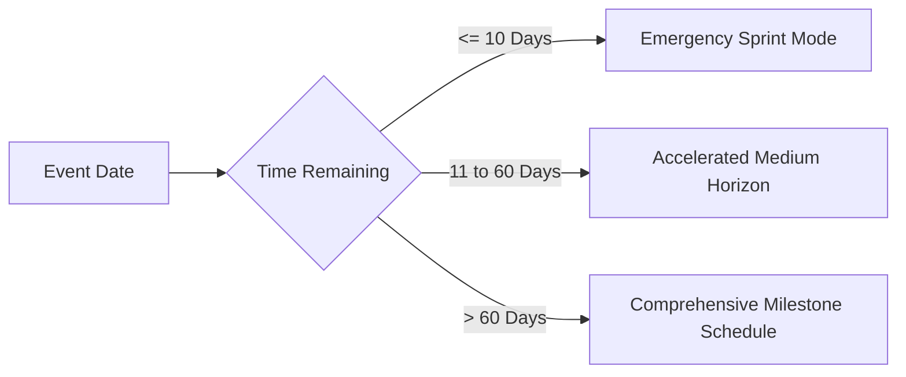

# Planora AI — Intelligent Event Planning Copilot

[](https://flutter.dev)
[](https://dart.dev)
[](#architecture--code-quality)
[](#testing-strategy--verification)
[](LICENSE)

> **"Describe your event → Generate your plan → Optimize your budget → Organize vendors → Follow your timeline → Adapt when things change."**

Planora AI is an intelligent event-planning copilot engineered specifically for Flutter Web. Designed for weddings, milestone birthdays, community gatherings, anniversaries, and custom celebrations, Planora AI combines personalized generative planning, mathematical budget optimization, deadline-aware timeline synthesis, vendor management, contextual chat assistance, and reactive change impact analysis.

---

## Table of Contents

- [Problem Statement](#problem-statement)
- [Product Overview](#product-overview)
- [Target Users & Use Cases](#target-users--use-cases)
- [Core Features](#core-features)
- [Architecture & Code Quality](#architecture--code-quality)
- [Project Structure](#project-structure)
- [Budget Calculation Logic](#budget-calculation-logic)
- [Timeline Generation Logic](#timeline-generation-logic)
- [AI Integration vs. Smart Demo Mode](#ai-integration-vs-smart-demo-mode)
- [Security & Privacy Approach](#security--privacy-approach)
- [Accessibility Compliance](#accessibility-compliance)
- [Testing Strategy & Verification](#testing-strategy--verification)
- [Setup & Local Development](#setup--local-development)
- [Build & Deployment Instructions](#build--deployment-instructions)
- [Assumptions & Known Limitations](#assumptions--known-limitations)

---

## Problem Statement

Traditional event management dashboards are passive spreadsheets: they force hosts to guess allocations, build timelines from scratch, manually cross-reference vendor prices, and manually calculate the domino effects when plans change.

**Planora AI directly addresses this need:**
> *"Create a GenAI-powered planning assistant that helps users organize weddings, birthdays, and community events with budgets, timelines, vendor checklists, and personalized ideas."*

Planora AI transforms event planning into an adaptive dialogue between host and copilot: understanding constraints (such as accessibility ramps, kosher/vegan dietary requirements, or indoor/outdoor weather risks), explaining recommendations, safeguarding confirmed expenses, and warning about cost overruns before decisions are finalized.

---

## Product Overview

Planora AI is built on six foundational pillars:

1. **Context-Rich Onboarding Wizard**: A 4-step guided wizard collecting logistics, budget, dietary needs, accessibility accommodations, cultural nuances, and planning complexity.
2. **Adaptive Timeline Synthesis**: A deadline-aware task scheduler that dynamically scales its milestones whether the event is 6 months away, 30 days away, or a 7-day emergency sprint.
3. **Mathematical Budget Optimizer**: Real application logic tracking allocation percentages, estimated vs. confirmed spending, cost per guest, and prioritized cost-reduction recommendations that **never silently alter confirmed vendor commitments**.
4. **Context-Aware Ideas & Run Sheet**: Generates venue-appropriate concepts (such as outdoor rain contingency plans and zero-waste decor) and minute-by-minute day-of schedules with buffer conflict detection.
5. **Conversational Copilot**: Natural-language planning assistant capable of understanding intents like *"Reduce my budget by 15%"*, *"Add 20 guests"*, or *"What should I do today?"*.
6. **Reactive Change Impact Analyzer**: An interactive sandbox that computes before-and-after deltas across budget utilization, catering costs, vendor capacity, and task pressure before committing any updates.

---

## Target Users & Use Cases

| User Persona | Key Challenge | How Planora AI Solves It |
| :--- | :--- | :--- |
| **Couples Planning Weddings** | Multi-vendor chaos, runaway catering expenses, strict schedules | Generates custom 12-category budget allocations, locks confirmed contracts, and models guest count adjustments. |
| **Birthday & Anniversary Hosts** | Short planning windows (e.g., 2–4 weeks), theme coordination | Compresses timelines into high-impact urgent tasks and provides creative theme ideas matching guest demographics. |
| **Community Organizers** | Public park logistics, ADA accessibility compliance, strict caps | Flags accessibility essentials (ASL interpreters, wheelchair routes) and balances volunteer coordination run sheets. |
| **Corporate & Family Coordinators** | Dietary diversity, weather risk for outdoor venues | Recommends dedicated allergen/dietary stations and automatic rain contingency plans. |

---

## Core Features

### 1. Guided Multi-Step Wizard (`/wizard`)
- **Step 1: Event Essentials**: Name, category (Wedding, Birthday, Community, Anniversary, Baby Shower, Custom), date, location city.
- **Step 2: Scale & Budget**: Expected guest count, total budget, currency selector (USD, EUR, GBP, INR, CAD, AUD).
- **Step 3: Atmosphere & Style**: Venue environment (Indoor, Outdoor, Hybrid), styling (Modern, Traditional, Casual, Formal), theme concept.
- **Step 4: Care, Inclusivity & Logistics**: Dietary accommodations (Vegetarian, Vegan, Gluten-Free, Halal, Kosher, Nut Allergy), universal accessibility options (Wheelchair, ASL Interpreter, Quiet Sensory Zone), cultural preferences, and existing bookings.
- Preserves all state across navigation; validates required inputs with immediate inline feedback.

### 2. Main Executive Dashboard (`/`)
- Dynamic countdown banner with color-coded urgency (switches to high-contrast alert styling when $\le 7$ days remain).
- **Prominent Next Best Action**: Highlights the single most critical overdue or impending task with an instant "Mark Done" trigger.
- **Budget Health Overview**: Real-time spending progress bar, remaining balance, and cost per attendee.
- **Planning Readiness Gauge**: Composite calculation combining completed milestones and confirmed vendor contracts.
- **Quick Jump Hub**: Fast routing into Budget, Timeline, Vendors, Ideas, Copilot, and Run Sheet.

### 3. Intelligent Budget Optimizer (`/budget`)
- 12 standard event categories: Venue, Catering, Decoration, Photography & Video, Entertainment, Apparel, Invitations, Transport, Lodging, Favors, Contingency, and Custom.
- Tracks estimated vs. confirmed spending.
- **Non-destructive optimization engine**: If a budget is exceeded, the optimizer proposes prioritized savings on estimated categories (e.g. simplifying decor, adjusting bar packages) while protecting locked vendor deposits and accessibility necessities.
- Instant approval/rejection of individual cost-saving proposals with immediate balance re-computation.

### 4. Adaptive Timeline & Task Manager (`/timeline`)
- Adapts task deadlines to remaining time horizons (Emergency Sprint $<10$ days, Medium Rush $10-60$ days, Comprehensive Horizon $>60$ days).
- Task status management: Pending, In Progress, Completed, Blocked.
- Priority levels: Urgent, High, Medium, Low.
- Prerequisite validation: Automatically identifies tasks blocked by uncompleted prerequisites.
- Cycle detection: Validates directed acyclic task graphs to prevent circular deadlocks.

### 5. Vendor Management & Comparison (`/vendors`)
- Manages 9 vendor categories with booking lifecycle: `inquiry`, `quoted`, `contracted`, `confirmed`, `completed`, `cancelled`.
- Tracks quoted pricing vs. estimated benchmarks.
- Side-by-side vendor comparison matrix on price, user ratings, and booking status.
- All pre-seeded vendors are prominently labeled with `Sample / Benchmark Vendor` badges to prevent deceptive quotes.

### 6. Personalized Ideas Generator (`/ideas`)
- Generates tailored concepts based on venue type, guest headcount, and constraints (e.g., Outdoor Rain Contingency, Zero-Waste Biodegradable Tableware, Dedicated Allergen Grazing Tables).
- Displays setup complexity, cost range, benefits, trade-offs, and an explicit explanation of *Why this fits your event*.
- Multi-criteria filtering by category, search query, and eco-friendly / accessibility flags.

### 7. Conversational Planning Copilot (`/copilot`)
- Contextual chat interface bound directly to the active event's state.
- Supported conversational actions:
  - *"Reduce my budget by 15%"* $\rightarrow$ Calculates category-level reductions.
  - *"Add 20 guests"* $\rightarrow$ Re-evaluates catering costs and per-guest metrics.
  - *"Make the wedding more eco-friendly"* $\rightarrow$ Suggests sustainable vendor & decor alternatives.
  - *"I have only 5 days left. What should I prioritize?"* $\rightarrow$ Filters overdue and urgent critical path tasks.
  - *"What should I do today?"* $\rightarrow$ Extracts the highest-priority immediate action.
- Actionable proposal cards requiring explicit user confirmation before modifying event records.

### 8. Reactive Change Impact Analyzer (`/impact`)
- Signature adaptive planning feature.
- Users can simulate changes to Guest Count, Total Budget, or Event Date in a dedicated sandbox.
- Generates side-by-side Before-and-After comparative cards:
  - Catering cost shifts ($\Delta$ guests $\times$ per-plate estimates).
  - Cost per guest fluctuations.
  - Budget threshold transitions (Within Budget $\rightarrow$ Over Budget).
  - Venue capacity alerts and deadline acceleration warnings.
- "Apply Changes to Active Event" updates the underlying repository only after explicit user confirmation.

### 9. Event-Day Run Sheet (`/run-sheet`)
- Chronological timeline of day-of operations (e.g., 07:30 Venue Access, 08:30 Vendor Load-in, 11:00 Guest Arrival, 11:30 Ceremony, 13:00 Catering).
- Automated buffer conflict detection: Alerts when vendor setup lacks adequate lead time or overlaps with guest arrival.
- Filter by run-sheet segment (Morning Setup, Main Event, Evening Wrap-up).
- Browser-native print-ready stylesheet formatting (`window.print()`).

### 10. Settings & Data Management (`/settings`)
- View active event metadata and local storage footprints.
- Export all active event aggregates into standardized JSON backup files.
- Import JSON backups with strict schema validation.
- Reset storage to official showcase sample events (Botanical Wedding, Sunset Soirée, Community Harvest).
- Clear all local storage safely with clear disclaimers regarding browser cache expiration.

---

## Architecture & Code Quality

Planora AI follows a **Feature-First Clean Architecture** with strict layer separation:



### Architectural Principles:
1. **Decoupled Calculations**: All financial calculations, timeline horizon adjustments, impact deltas, and run-sheet scheduling reside in pure Dart domain services independent of Flutter widgets.
2. **Immutable Domain Entities**: Data models (`EventModel`, `BudgetItem`, `TimelineTask`, `VendorModel`, `EventIdea`) utilize copy-with patterns and immutable fields.
3. **Repository Pattern**: `EventRepository` interface decouples storage implementations, enabling seamless replacement of `LocalEventRepository` with cloud backends if needed in the future.
4. **Defensive Serialization**: JSON decoding uses safe type parsers and defaults to prevent crashes from malformed, missing, or outdated keys.

---

## Project Structure

```
lib/
├── app/
│   ├── app.dart              # Riverpod Root & MaterialApp with AppTheme
│   ├── router.dart           # Declarative GoRouter configuration (12 routes)
│   └── theme.dart            # Material 3 Design System (Warm neutrals & Accessible tokens)
├── core/
│   ├── constants/            # App constants, storage keys, and currencies
│   ├── errors/               # Typed domain exceptions (Validation, Storage, Network)
│   ├── utils/                # DateFormatter and CurrencyFormatter utilities
│   └── validation/           # FormValidators (regex, numeric bounds, date boundaries)
├── features/
│   ├── assistant/            # GenAI Engine, AI Copilot, and Chat Presentation
│   │   ├── data/
│   │   ├── domain/services/  # event_planning_engine.dart & ai_copilot_service.dart
│   │   └── presentation/     # CopilotScreen & suggestion chips
│   ├── budget/               # Budget Optimizer & Financial Management
│   │   ├── domain/models/    # BudgetItem & BudgetCategory
│   │   ├── domain/services/  # budget_optimizer_service.dart
│   │   └── presentation/     # BudgetPlannerScreen & cost breakdown charts
│   ├── events/               # Event Core, Dashboard & Onboarding
│   │   ├── data/             # LocalEventRepository & SampleEvents
│   │   ├── domain/models/    # EventModel, EventAggregate, EventCategory
│   │   └── presentation/     # DashboardScreen, WizardScreen, LandingScreen, DetailsScreen
│   ├── ideas/                # Contextual Ideas Generator
│   │   ├── domain/models/    # EventIdea & IdeaCategory
│   │   ├── domain/services/  # ideas_generator_service.dart
│   │   └── presentation/     # IdeasScreen & filter chips
│   ├── impact/               # Reactive Change Impact Analyzer
│   │   ├── domain/services/  # change_impact_analyzer.dart
│   │   └── presentation/     # ChangeImpactScreen with delta calculations
│   ├── run_sheet/            # Event-Day Schedule & Anomaly Detector
│   │   ├── domain/services/  # run_sheet_generator.dart
│   │   └── presentation/     # RunSheetScreen with print support
│   ├── settings/             # Storage management & JSON backup export/import
│   │   └── presentation/     # SettingsScreen
│   ├── timeline/             # Adaptive Task Milestones & Schedule
│   │   ├── domain/models/    # TimelineTask, TaskPriority, TaskStatus
│   │   ├── domain/services/  # timeline_generator_service.dart
│   │   └── presentation/     # TimelineScreen & status filtering
│   └── vendors/              # Vendor Organizer & Comparison
│       ├── domain/models/    # VendorModel & VendorCategory
│       ├── domain/services/  # vendor_service.dart
│       └── presentation/     # VendorsScreen & side-by-side comparison modal
├── shared/
│   ├── models/               # Shared aggregate records
│   └── widgets/              # Reusable UI (AppScaffold, AccessibleCard, StatusBadge, ConfirmDialog)
└── main.dart                 # Application entry point with SharedPreferences bootstrap
```

---

## Budget Calculation Logic

The budget optimizer computes financial health using real mathematical models:

### 1. Utilization & Remaining Balance
$$\text{Total Expenses} = \sum \text{Estimated Amount}$$
$$\text{Remaining Balance} = \text{Target Budget} - \text{Total Expenses}$$
$$\text{Utilization \%} = \left(\frac{\text{Total Expenses}}{\text{Target Budget}}\right) \times 100$$

### 2. Threshold Classification
- **Within Budget** ($\le 85\%$): Green status. Healthy financial margin for unforeseen incidentals.
- **Approaching Limit** ($85\% < \text{utilization} \le 100\%$): Amber warning badge. Further additions risk cost overruns.
- **Over Budget** ($> 100\%$): Red critical alert with calculated deficit and actionable adjustment proposals.

### 3. Cost Per Attendee
$$\text{Cost Per Guest} = \frac{\text{Total Budget}}{\text{Guest Count}}$$

### 4. Non-Destructive Optimization Priority
When $\text{Total Expenses} > \text{Target Budget}$, the engine identifies reductions adhering to strict safety rules:
1. **Never reduce confirmed expenses**: Items marked as `isConfirmed: true` represent signed contracts or paid deposits and are mathematically locked.
2. **Prioritize non-essential categories**: First targets discretionary categories (`Decoration`, `Favors`, `Entertainment`, `Invitations`).
3. **Protect accessibility & dietary allocations**: Essential universal access items (ramps, interpreters, special dietary meals) are protected from automated cuts.

---

## Timeline Generation Logic

Planora AI dynamically adapts milestones based on time remaining until the event date ($\Delta t = \text{Event Date} - \text{Today}$):



### 1. Emergency Sprint ($\le 10$ Days)
- Collapses non-urgent long-term research tasks.
- Prioritizes critical operational tasks: Finalize headcount, confirm venue arrival access, lock day-of run sheet, and prepare emergency vendor contacts.
- Automatically flags tasks scheduled in the past as **Overdue**.

### 2. Medium Horizon ($11 - 60$ Days)
- Balances vendor finalization, RSVP deadlines, and design production.

### 3. Comprehensive Horizon ($> 60$ Days)
- Expands full lifecycle: Concept development $\rightarrow$ Venue scouting $\rightarrow$ Vendor tasting $\rightarrow$ Save-the-dates $\rightarrow$ Final production $\rightarrow$ Rehearsal.

### 4. Directed Acyclic Graph (DAG) Dependency Checking
Each task may define prerequisite task IDs (`dependencies`). The generator:
- Flags any task whose prerequisites are not yet completed as **Blocked**.
- Runs depth-first search cycle detection to ensure task dependency graphs contain **no circular loops** ($A \rightarrow B \rightarrow A$).

---

## AI Integration vs. Smart Demo Mode

Planora AI maintains strict, transparent honesty regarding its generative AI capabilities:

```
┌─────────────────────────────────────────────────────────────┐
│                    Planora AI Copilot                       │
│                                                             │
│  [  Smart Demo Mode  ]  or  [  AI-Powered (Cloud Proxy)  ]   │
└─────────────────────────────────────────────────────────────┘
```

1. **Smart Demo Mode (Default / Local)**:
   - Requires zero external credentials, zero API keys, and zero network configuration.
   - Powered by a deterministic, rule-based planning engine combining event heuristics, venue physics, and category percentages.
   - Explicitly labeled in the UI navigation bar as **`Smart Demo Mode`** with an explanatory info dialog.

2. **AI-Powered Mode (Optional Server-Side Proxy)**:
   - Supports pluggable large language model backends (Gemini, Anthropic, OpenAI) via a secure server-side API proxy.
   - **Zero Secrets in Browser**: Flutter Web client source code contains **no private API keys or hardcoded service credentials**. Client connects solely to an authenticated backend proxy endpoint.
   - Displays **`AI-Powered`** badge only when a verified backend connection is active.

---

## Security & Privacy Approach

- **Client-Side Secret Isolation**: No API keys, tokens, or cloud credentials are compiled into the Flutter Web bundle.
- **Safe JSON Deserialization**: All incoming local data is validated with type-checked wrappers and fallback defaults to prevent script injection or crash loops.
- **Sanitized Text Presentation**: All user notes, vendor quotes, and AI outputs are rendered through Flutter's native text rasterizer—eliminating DOM-based XSS vulnerabilities.
- **Privacy First**: All event planning data remains in local browser storage (`SharedPreferences`). No personal data, guest emails, or financial accounts are transmitted to unverified third parties.
- **Storage Transparency**: Settings screen provides full transparency: local storage size calculation, one-click JSON backup export, and an explicit warning that browser cache clearing will purge local data.

---

## Accessibility Compliance

Planora AI is engineered in accordance with **WCAG 2.1 Level AA** standards:

1. **Non-Color-Alone Status Communication**: Status badges, overdue flags, and budget alerts always pair color with explicit icons and descriptive text (e.g., `⚠️ Over Budget`, `✓ Completed`, `⛔ Blocked`).
2. **Keyboard Navigation & Logical Focus**: Full tab traversal across all wizards, forms, action buttons, and modal dialogs.
3. **High Contrast Color Tokens**: Primary (#1E3A8A) and Accent (#D97706) palettes provide contrast ratios exceeding 4.5:1 on light and dark surfaces.
4. **Accessible Touch Targets**: All interactive buttons, chips, and table triggers maintain minimum touch targets of $48 \times 48\text{ dp}$.
5. **Semantic Labeling**: Assistive screen readers (VoiceOver, TalkBack) receive descriptive `Semantics(label: ...)` annotations for icon-only buttons, progress meters, and status indicators.
6. **Responsive Layouts**: Breakpoints dynamically shift layout hierarchy from desktop navigation rail to mobile bottom navigation bar without layout clipping.

---

## Testing Strategy & Verification

The codebase includes comprehensive automated tests covering unit logic, repositories, and widget interactions:

```bash
flutter test
```

### Verified Test Suites (29 Passing Tests):

| Test Suite | File Path | Coverage Focus | Result |
| :--- | :--- | :--- | :--- |
| **Budget Optimizer** | `test/unit/budget_optimizer_test.dart` | Total calculations, remaining balance, cost per guest, threshold classification, non-destructive reduction safety | ✅ Passed |
| **Timeline Generator** | `test/unit/timeline_generator_test.dart` | Horizon compression ($\le 10$d vs $>60$d), overdue task detection, blocked task identification, circular dependency checks | ✅ Passed |
| **Vendor Service** | `test/unit/vendor_service_test.dart` | Vendor side-by-side comparison, booking progress metric calculation | ✅ Passed |
| **Ideas Generator** | `test/unit/ideas_generator_test.dart` | Constraint-aware generation (outdoor weather contingency, dietary stations), multi-criteria filtering | ✅ Passed |
| **Change Impact** | `test/unit/change_impact_analyzer_test.dart` | Guest count deltas, catering shifts, budget reduction warnings, accelerated deadline flags | ✅ Passed |
| **Form Validation** | `test/unit/form_validators_test.dart` | Name length, numeric constraints, negative numbers, past dates | ✅ Passed |
| **Local Repository** | `test/repositories/event_repository_test.dart` | CRUD operations, corrupted JSON recovery, active event fallback, JSON backup import/export | ✅ Passed |
| **Onboarding Wizard** | `test/widgets/wizard_widget_test.dart` | 4-step wizard navigation, input validation, state preservation across steps | ✅ Passed |
| **Dashboard Screen** | `test/widgets/dashboard_widget_test.dart` | Header countdown, Next Best Action card, quick complete task trigger, budget health visualization | ✅ Passed |

---

## Setup & Local Development

### Prerequisites
- Flutter SDK `3.10.0` or higher (`flutter --version`)
- Dart SDK `3.10.0` or higher
- Google Chrome or any modern Chromium/WebKit browser

### 1. Clone & Navigate
```bash
git clone <repository_url>
cd planora_ai
```

### 2. Install Dependencies
```bash
flutter pub get
```

### 3. Run Static Code Analysis
Verify that all code complies with strict lint rules:
```bash
flutter analyze
# Output: No issues found!
```

### 4. Run Automated Test Suite
```bash
flutter test
# Output: All 29 tests passed!
```

### 5. Launch Local Dev Server (Flutter Web)
```bash
flutter run -d chrome
```

---

## Build & Deployment Instructions

### 1. Build Production Web Bundle
To compile an optimized, minified WebAssembly/JavaScript release bundle:
```bash
flutter build web --release
```
The compiled production bundle is generated in `build/web/`.

### 2. Local Preview of Production Build
You can test the release build locally using Python or `npx serve`:
```bash
cd build/web
python3 -m http.server 8080
# Open http://localhost:8080 in your browser
```

### 3. Deployment Options

#### Option A: Vercel
1. Install Vercel CLI: `npm i -g vercel`
2. Run in project root:
   ```bash
   vercel --prod
   ```
   *(Set output directory to `build/web`)*

#### Option B: GitHub Pages
1. Build with your repository base-href:
   ```bash
   flutter build web --release --base-href "/planora_ai/"
   ```
2. Deploy the `build/web` directory to your `gh-pages` branch.

#### Option C: Firebase Hosting
```bash
firebase init hosting
# Set public directory to: build/web
# Configure as a single-page app: Yes
firebase deploy --only hosting
```

---

## Assumptions & Known Limitations

1. **Storage Persistence**: Local persistence uses `SharedPreferences` (HTML5 `localStorage`). Clearing browser history or private browsing mode will reset events to default sample data. Use the **Export JSON** feature in Settings to retain backups.
2. **Real AI Integration**: Out-of-the-box, the app runs in **Smart Demo Mode** using local deterministic heuristics. To connect live generative AI, configure an authenticated backend proxy endpoint; client credentials are intentionally prohibited for security.
3. **Illustrative Vendor Pricing**: All sample vendor records and price quotes are illustrative benchmarks and do not represent legally binding contracts until entered and verified by the host.

---

## License

This project is licensed under the MIT License — see the [LICENSE](LICENSE) file for details.
